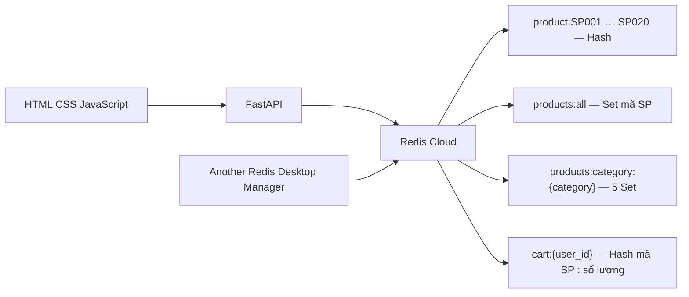

# Kiến trúc và dữ liệu

Catalogue hiện tại có thêm brand, model, specs (JSON string trong Hash, object khi trả API), manufacturer_url, image_source_page, image_origin_url và price_kind=illustrative. image là đường dẫn /assets/images/products/SPxxx.webp; binary ảnh nằm trên filesystem, không nằm trong Redis. Import catalogue giữ nguyên stock và mọi giỏ/đơn hiện có.

Frontend cùng origin → FastAPI → redis-py → Redis Cloud. Another Redis Desktop Manager kết nối riêng đến Redis Cloud để xem Hash, Set và TTL; không nằm trong luồng xử lý web.

Hash sản phẩm gồm product_id, name, description, price_vnd, category, image, stock. Giá VNĐ là số nguyên. Sản phẩm và Set không được đặt TTL. Hash giỏ chứa số lượng, TTL 86400 giây (24 giờ) được làm mới khi thay đổi. Đọc giỏ không kéo dài TTL. Redis tự xóa key khi field cuối cùng bị xóa.

Giao dịch WATCH/MULTI/EXEC bảo vệ cộng dồn và giới hạn 99 khi thay đổi đồng thời. Giá và tên được đọc lại từ Redis khi tính giỏ. Xác nhận mua mô phỏng kiểm tra toàn bộ kho rồi trừ kho, lưu đơn và xóa giỏ trong một giao dịch; mã idempotency lưu kết quả chống trùng. Không có thanh toán tiền thật hoặc đăng nhập. Xem checkout.md.
